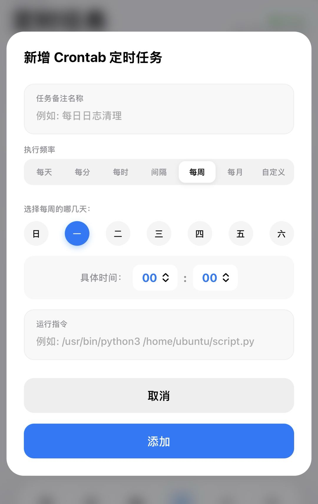

# web-crontab-timer

一个极轻量、高颜值的 Linux Crontab + Systemd Timer 定时任务 Web 管理面板。

[](LICENSE)

<p align="center">
  
</p>

---

## 🌟 项目亮点

* 📱 **iOS 风格极简设计**：高度适配移动端，支持自适应卡片布局、柔和的原生色彩与顺滑的过渡动画。
* ⏰ **Crontab 与 Systemd Timer 双引擎**：同时管理传统的用户级 Crontab 以及现代 Linux 的 Systemd 定时器（一键启用/禁用、读取服务运行状态）。
* 📅 **全图形化时间配置器**：
  - **分段选项卡**：可在每天、每分、每小时、间隔小时、每周、每月等场景下快速切换。
  - **星期选择器**：圆形星期快捷键点击，支持多选。
  - **日历网格选择器**：`1-31` 号系统级日历网格交互，带 **“多选日期”** 动态开关，可自由拼接多选/单选执行日期。
* ⚡ **手动测试功能**：一键在系统后台异步执行测试指令（`▶` 立即执行），并能随时删除（`🗑️`）不再需要的任务。
* 🛡️ **健壮性与防溢出设计**：命令超长时自动截断，且移动端操作控件带防缩水（`flex-shrink: 0`）与点击穿透防护，对超长指令完美兼容。

---

## 🛠️ 安装与部署

### 1. 克隆项目与初始化

```bash
git clone https://github.com/YourUsername/web-crontab-timer.git
cd web-crontab-timer
```

### 2. 快捷脚本一键安装 (推荐)

项目自带了一键部署脚本，会自动创建虚拟环境、安装依赖并将服务注册为 Systemd 守护进程运行在指定端口上（默认 `5000`）：

```bash
# 给予可执行权限并运行（需要 sudo 权限以读取/写入 crontab 与 systemctl）
chmod +x deploy/install.sh
sudo ./deploy/install.sh 5000
```

安装完成后，可直接访问 `http://你的服务器IP:5000`。

### 3. 手动运行

若要在开发环境手动测试运行：

```bash
# 创建并激活虚拟环境
python3 -m venv venv
source venv/bin/activate

# 安装依赖
pip install -r requirements.txt

# 运行（推荐使用 sudo 运行以确保能获取到系统 sudo crontab -l）
sudo python3 app.py
```

---

## 🔒 权限说明

由于面板需要执行以下敏感命令：
* `sudo crontab -l` 和 `sudo crontab -` 来读取及修改系统 Crontab 任务。
* `systemctl` 及 `sudo systemctl enable/disable` 来控制 Systemd 定时器。

因此，建议通过 `sudo` 或以 `root` 权限运行此 Web 服务，以保证定时管理功能正常运作。

---

## 📄 开源协议

本项目采用 [MIT License](LICENSE) 协议开源。
